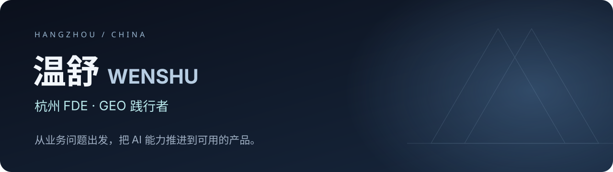

<a href="https://wenshu.tnyma.com/">个人官网</a> · <a href="https://wenshu.tnyma.com/projects.html">项目案例</a> · <a href="https://github.com/1319974153-ui/guanyin-geo">观引 GEO</a> · <a href="https://wenshu.tnyma.com/contact.html">联系合作</a>

## 你好，我是温舒

常驻杭州，关注 **FDE 实践、企业 AI 应用落地与 GEO**。从理解业务流程、梳理需求，到产品设计、全栈开发、模型接入与部署迭代，让 AI 能力进入具体工作流程。

我希望把项目做成可使用、可检查、能持续改进的产品。这里记录正在维护的开源项目与可公开的实践。

## 项目与实践

| 项目 | 解决什么问题 | 了解更多 |
|---|---|---|
| **观引 GEO** | 整理品牌事实、辅助内容创作、多平台发布与真实引用记录 | [开源仓库](https://github.com/1319974153-ui/guanyin-geo) · [下载测试版](https://github.com/1319974153-ui/guanyin-geo/releases/tag/v0.49.0-beta.2) |
| **拾帧 · 新媒体 2.0** | 围绕内容生产和新媒体工作流的产品实践，持续修复与验证 | [产品介绍](https://wenshu.tnyma.com/cases/shizhen-newmedia.html)；闭源，不提供源码和下载 |
| **AI 面试数字人** | 参与 AI 交互与面试场景的产品实践 | [项目与参与范围](https://wenshu.tnyma.com/projects.html) |
| **电商自动化** | 参与业务资料整理与操作流程自动化实践 | [项目与参与范围](https://wenshu.tnyma.com/projects.html) |

项目的具体职责、完成阶段与公开依据以各案例页面为准。

## 我正在关注

- **AI 应用落地**：从具体业务问题出发，连接模型、数据与操作流程。
- **GEO**：建立可核实的品牌资料，区分发布、收录、引用与主动推荐。
- **产品体验**：减少重复填写，让用户看得懂下一步，也看得清真实结果。

## 沟通合作

如果你正在梳理企业 AI 应用、内容工作流或 GEO 需求，可以先看看[项目案例](https://wenshu.tnyma.com/projects.html)，再通过[官网联系方式](https://wenshu.tnyma.com/contact.html)沟通业务场景、现有流程与预期目标。

---

观引自有源码采用 MIT 许可；外部模型、云服务与平台费用另计。部分工程与文档使用 AI 辅助，公开项目能力以实际验证结果为准。
